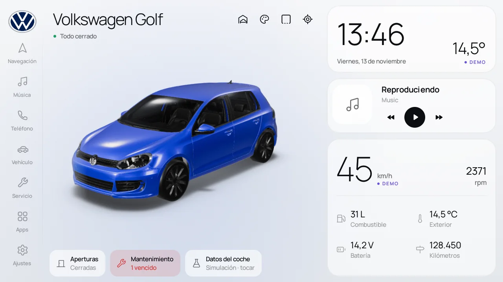
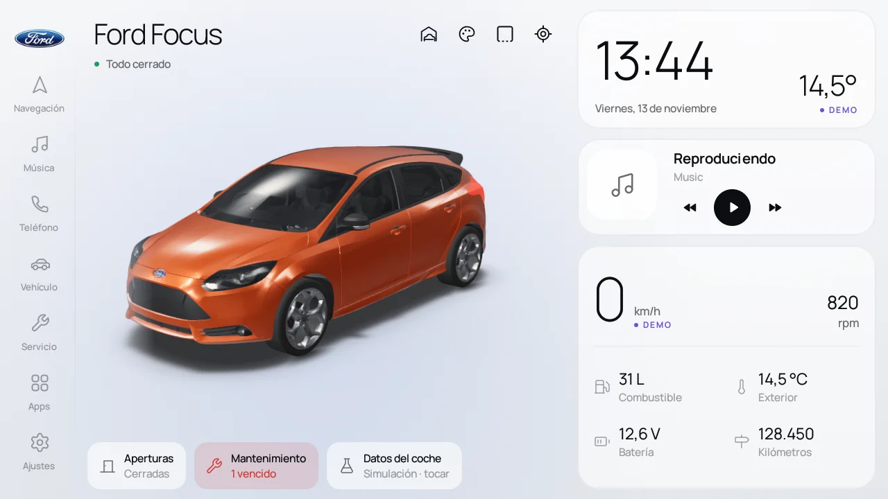
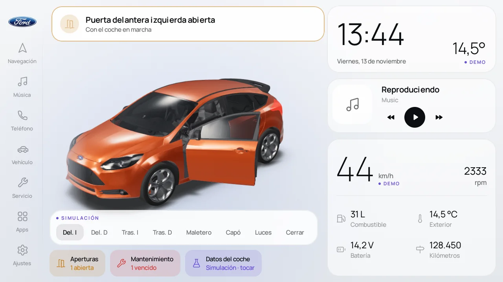
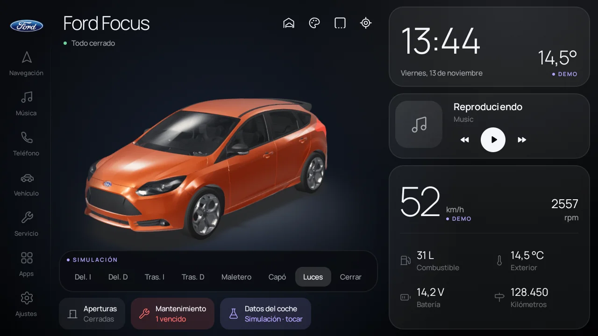
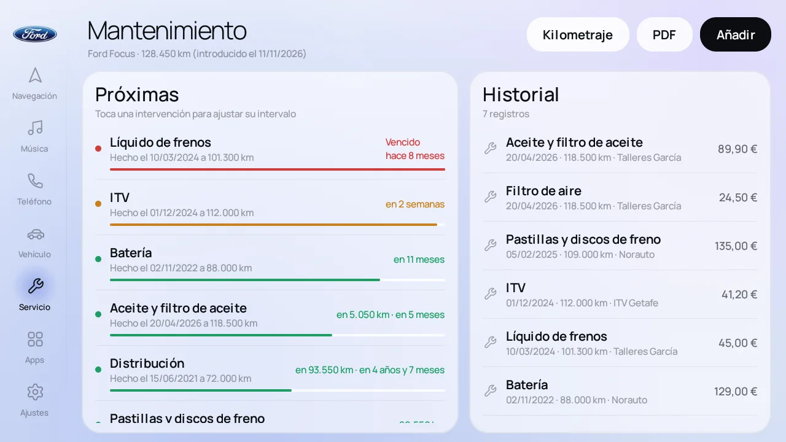

# CarVision Launcher

**Pantalla de inicio para radios Android de coche con tu coche en 3D en tiempo real.**
*An Android head-unit launcher that shows your own car in real-time 3D: doors, bonnet and boot that open, your colour
and your brand's boot logo. Kotlin + Jetpack Compose + Filament, a Blender pipeline that turns Sketchfab models into
"vehicle packs", and a Next.js shop with Stripe. Spanish UI and docs.*



| | |
|---|---|
|  |  |
|  |  |

> Capturas reales de la app (emulador 1280×720). La velocidad, las puertas y los datos del viaje se ven en **modo
> demostración**: la lectura del CAN del coche todavía no está hecha (ver [Estado](#estado)).

## Qué hace

- **Tu coche en 3D** (Filament, PBR, fondo transparente): giro con el dedo con inercia, vista en planta, ruedas que
  giran, y **puertas, capó y maletero que se abren** de forma animada según el modelo de cada coche.
- **Arranque con el logotipo de tu marca**: animación propia que espera a que el coche esté dibujado para no dejar un
  hueco en pantalla.
- **Color y logotipo a tu gusto** en el Garaje; ambientes de luz; tema claro / oscuro / automático (por hora o con las
  luces del coche).
- **Inicio completo**: reloj, música (carátula y mandos de cualquier app), datos del viaje, accesos a navegación,
  teléfono y apps.
- **Carnet de mantenimiento** con avisos y exportación a PDF; ordenador de a bordo e historial de viajes.
- **Coches intercambiables** ("vehicle packs": `manifest.json` + `model.glb`) que se instalan desde un pendrive o un
  `.zip`, con validador.
- **Respaldo 2D** si la GPU de la radio no tiene OpenGL ES 3.0.
- **Sin root**: no toca el firmware de la radio, no escribe nada en el CAN del coche y no pide permisos innecesarios.

## Arquitectura

```
android/                    Kotlin 2.0 · Jetpack Compose · Filament 1.75 (gltfio) · minSdk 26
  app/                      Launcher: pantallas, navegación, ajustes (DataStore), arranque, avisos
  core/model/               Señales normalizadas del vehículo (Kotlin puro)
  core/designsystem/        Tema OEM+ (colores, tipografía Manrope, iconos), claro y oscuro
  core/maintenance/         Carnet de mantenimiento (Kotlin puro, con tests)
  vehicle/data/             VehicleDataProvider: sin conexión y demo; punto de entrada para adaptadores CAN
  vehicle/packs/            Formato de pack, parser, validador e importador de .zip
  render3d/                 Visor 3D (TextureView + Filament), animaciones de aperturas, respaldo 2D
blender/
  carvision_pack_builder/   Add-on y motor que convierte un modelo descargado en un pack listo para la app
  scripts/                  Escena, logotipos de marca, validación y utilidades
vehicle-packs/              Coches del catálogo (Ford Focus MK3, VW Golf VI) y el coche por defecto
web/                        Next.js 16 · React 19 · Stripe Checkout · enlaces firmados HMAC, sin base de datos
docs/                       Guías, decisiones y capturas
```

Decisiones que vale la pena mirar:

- **El coche es un dato, no código.** Cada pack declara sus piezas móviles (eje, ángulo, sentido) en el manifiesto y el
  visor las anima sin saber de qué coche se trata (`docs/VEHICLE_PACKS.md`).
- **Pipeline en Blender** que orienta, escala y limpia un modelo de Sketchfab, detecta ruedas y huecos de puertas,
  separa las piezas móviles con sus bisagras y termina cada coche a mano con un script propio (`finish_*.py`)
  (`docs/BLENDER_PIPELINE.md`).
- **Rendimiento en radios modestas**: el visor solo dibuja cuando algo cambia, salta fotogramas si la GPU va justa y
  la APK se divide por arquitectura.
- **Tienda sin base de datos**: las compras viven en Stripe y el acceso a las descargas es un enlace firmado con HMAC
  que solo el servidor puede fabricar; las descargas salen por una función que transmite el archivo por partes.

Todas las decisiones, con su porqué, están en [`DECISIONS.md`](DECISIONS.md).

## Estado

Versión **1.0.0** ([CHANGELOG](CHANGELOG.md), [estado detallado](PROJECT_STATUS.md), [limitaciones
conocidas](KNOWN_LIMITATIONS.md)).

- ✅ App completa y probada en emulador (1024×600 y 1280×720).
- 🟡 Primera prueba en una radio real en curso.
- ⏳ Lectura del CAN del coche: pendiente (la app muestra "sin conexión" o modo demo, nunca datos inventados como si
  fueran reales).

## Compilar

Requisitos: JDK 17 y Android SDK 34.

```bash
cd android
./gradlew test assembleDebug      # depuración
./gradlew assembleRelease         # versión optimizada (firma: docs/GUIA_DESARROLLADOR.md)
```

La APK de cada versión está en [Releases](../../releases). Emulador recomendado: tablet 1280×720 o 1024×600, Android
8.1+, lanzado con `-gpu host -feature GLESDynamicVersion` para tener OpenGL ES 3.

Web: `cd web && npm install && npm run dev` (http://localhost:3100; variables en `web/.env.example`).

## Documentación

| Documento | Para |
|---|---|
| [`docs/INSTALACION.md`](docs/INSTALACION.md) | Instalar CarVision en una radio |
| [`docs/VEHICLE_PACKS.md`](docs/VEHICLE_PACKS.md) | Formato de los coches e importación |
| [`docs/GUIA_DESARROLLADOR.md`](docs/GUIA_DESARROLLADOR.md) | Compilar, firmar, añadir un adaptador CAN o un coche |
| [`docs/BLENDER_PIPELINE.md`](docs/BLENDER_PIPELINE.md) | Preparar un modelo 3D en Blender |
| [`docs/CREAR_MI_COCHE.md`](docs/CREAR_MI_COCHE.md) | Poner tu coche con el panel de Blender |
| [`docs/RADIOS.md`](docs/RADIOS.md) | Radios Android compatibles y requisitos |
| [`docs/PRUEBA_RADIO_FOCUS.md`](docs/PRUEBA_RADIO_FOCUS.md) | Plan de la primera prueba en una radio real (1 GB, Android 10 Go) |
| [`docs/WEB.md`](docs/WEB.md) | La tienda web |

## Licencia y créditos

Código © 2026 Juan Antonio Martín Nadales. **Todos los derechos reservados**: el código se publica para que se pueda
ver, no para reutilizarlo (ver [`LICENSE`](LICENSE)). El add-on de Blender (`blender/carvision_pack_builder/`) es
GPL v3, como exige Blender.

Los modelos 3D parten de modelos de Sketchfab con licencia CC BY 4.0 y las fuentes e iconos tienen sus propias
licencias: ver [`THIRD_PARTY_NOTICES.md`](THIRD_PARTY_NOTICES.md). CarVision no está afiliada a Ford, Volkswagen ni a
ningún otro fabricante; sus nombres y logotipos son marcas de sus dueños.
